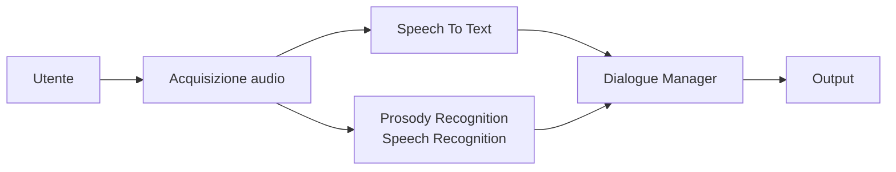
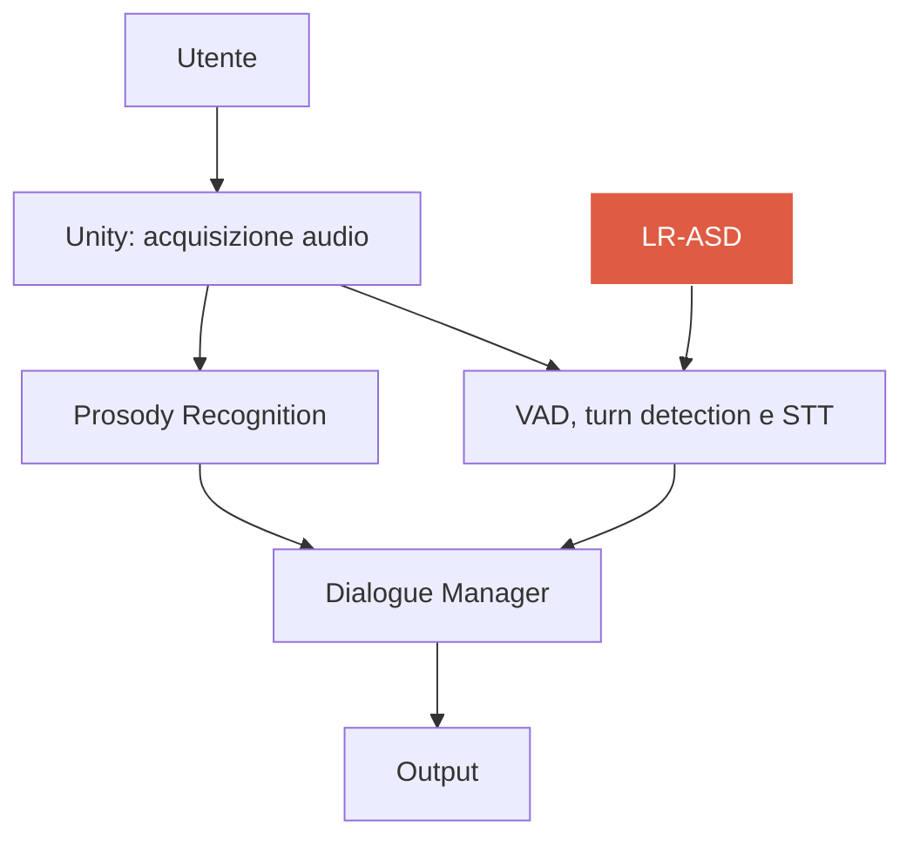
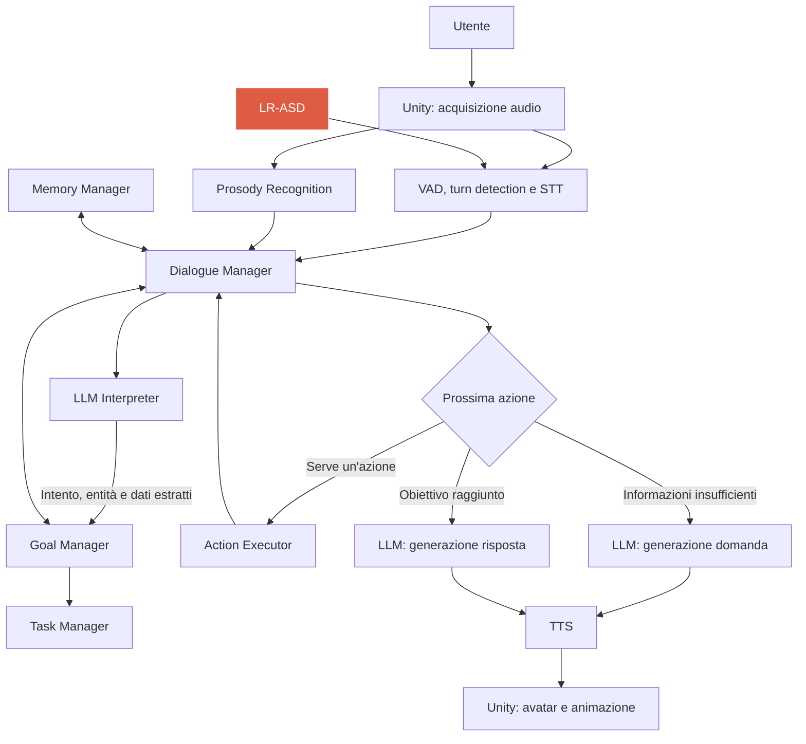

## Obiettivo

Sviluppare un'architettura che permetta a un avatar 3D in Unity di conversare in modo naturale, riconoscere quando qualcuno ha finito di parlare, comprendere le richieste, rispondere, ricordare le interazioni precedenti e prendere l'iniziativa quando mancano informazioni necessarie per completare un compito. Prevedere più modalità di uso (assistente, moderatore, ...)

Il paper "[An End-to-End Conversational Style Matching Agent](https://arxiv.org/pdf/1904.02760)" studia lo sviluppo di agenti che si adattino allo stile di conversazione degli utenti, di come questi reagiscono e di conseguenza al fattore di fiducia che gli utenti ripongono in questi. L'architettura descritta nello studio è una buona base di partenza per il nostro progetto.

L'audio acquisito passa ad un modulo di Prosody/Speech Recognition, che estrae alcune delle caratteristiche del linguaggio parlato come intonazione, accento, ritmo, durata e volume per fare Sentiment Analysis ed Emotion Recognition. Questo, insieme al dialogo trascritto da uno Speech To Text vengono mandati ad un modulo di Dialogue Manager che fa da orchestratore, gestendo i vari input e decidendo in che direzione deve andare la conversazione.
Non sono esplicitamente segnalati nel documento, ma per rendere la conversazione naturale servono anche altri moduli. La prima cosa da introdurre è un sistema in grado di capire quando l'utente prende parola, in caso anche interrompendo l'avatar mentre è lui a parlare. 
Le due tecnologie più importanti sono:
- VAD - Voice Activity Detection. Verifica attraverso elaborazione del segnale e machine learning la presenza o assenza di voce umana nel flusso audio 
- Turn Detection - Processo con cui si cerca di capire quando l'utente inizia e finisce di parlare, che può anche includere il VAD
Noi abbiamo però anche un terzo tipo di verifica: nel progetto sviluppato dai colleghi, sono già introdotti alcuni moduli che permettono di fare altre stime. La più importante tra queste è quella dell'Active Speaker Detection implementata col modello LR-ASD che appunto ci aiuta a capire se qualcuno sta parlando. Una lista dei moduli che ci possono essere utili:
- LR-ASD - per i motivi appena detti
- Face Tracker -  per verificare la presenza e la posizione di un volto
- Head Pose Estimation - ci dice in che posizione è il volto, utile per sapere se l'utente è rivolto verso l'avatar
- Engagement Module - per verificare che l'utente rilevato sia quello che sta parlando
Possiamo quindi avere delle informazioni del tipo:
```json
{
  "track_id": 7,
  "visible": true,
  "head_pose": {"yaw": 8.2, "pitch": -3.1, "roll": 0.5},
  "speaking_score": 0.82,
  "engaged": true
}
```
che possono essere usate per rafforzare o andare contro le decisioni degli altri moduli.  

La parte di input sarebbe così completa. Si passa ora alla parte più importante: il Dialogue Manager, quello che decide in che direzione sta andando la conversazione, che azioni compiere e che orchestra tutti gli altri moduli.
Possiamo definire alcuni dei requisiti funzionali del Dialogue Manager:
- Valutare e gestire le richieste dell'utente attraverso un Goal Manager
- Gestire una memoria 
- In base alla richiesta:
	- se ha bisogno di informazioni aggiuntive, fare domande per ottenerle
	- se ha tutte le informazioni, rispondere
	- effettuare un'azione come modificare un calendario, o scrivere una mail

Il Dialogue Manager riceve in input la trascrizione del STT, i dati dal prosody rec., e i dati dal LR-ASD, e usa un llm per ricevere una decomposizione strutturata della richiesta (informazioni richieste, intento, scomposizione in task atomici).

Responsabilità principali:
- **Gestione del contesto conversazionale:** mantiene il contesto necessario per interpretare i messaggi dell'utente, considerando la cronologia recente e le informazioni recuperate dalla memoria.
- **Coordinamento degli obiettivi:** consulta il Goal Manager per conoscere gli obiettivi attivi, i relativi vincoli e le informazioni ancora necessarie per raggiungerli.
- **Selezione della prossima azione:** determina come procedere in base allo stato corrente. Per esempio, può richiedere un chiarimento, rispondere direttamente, avviare un'attività o comunicare il risultato di un'operazione. 
- **Gestione dei chiarimenti:** quando mancano informazioni indispensabili, coordina la richiesta di ulteriori dettagli all'utente, evitando di avviare attività che non possono ancora essere completate correttamente.
	- In [Clarify When Necessary: Resolving Ambiguity Through Interaction with LMs](https://aclanthology.org/2025.findings-naacl.306.pdf) viene proposto un algoritmo per decidere se una richiesta è sufficientemente chiara oppure se conviene chiedere all'utente di specificare meglio cosa intende. Non serve per valutare la completezza delle informazioni in nostro possesso, ma potrebbe essere un modulo aggiuntivo.
- **Coordinamento dell'esecuzione:** richiede l'esecuzione delle operazioni necessarie tramite l'Action Executor e gestisce i risultati restituiti.
- **Gestione delle risposte:** stabilisce quando è possibile rispondere, quali informazioni includere e quando una risposta deve essere seguita da un'altra azione.
- **Gestione del flusso conversazionale:** coordina i passaggi tra elaborazione della richiesta, eventuali chiarimenti, esecuzione delle attività e formulazione della risposta finale.

```
Trascrizione STT
       │
       ▼
Dialogue Manager
       │
       ├── Recupero del contesto dalla memoria
       │
       ├── Interpretazione della richiesta tramite LLM
       │
       ├── Consultazione del Goal Manager
       │        │
       │        └── Obiettivi e informazioni mancanti
       │
       ├── Decisione su come procedere
       │        │
       │        ├── Risposta diretta
       │        │
       │        ├── Richiesta di chiarimenti
       │        │
       │        └── Esecuzione di un'attività
       │                 │
       │                 ▼
       │           Action Executor
       │                 │
       │                 ▼
       │           Risultato dell'azione
       │
       ▼
Preparazione della risposta
       │
       ▼
TTS → Avatar
```

Una possibile pipeline iniziale potrebbe essere la seguente:



# Studio dell'implementazione
## 1. Framework
Esistono diversi framework che forniscono una struttura già abbastanza completa per la pipeline, permettendo di aggiungere moduli e personalizzare ogni fase.

| Pipecat           | [Docs](https://docs.pipecat.ai/overview/introduction)  [GitHub](https://github.com/pipecat-ai/pipecat)          |
| ----------------- | --------------------------------------------------------------------------------------------------------------- |
| LiveKit Agents    | [Docs](https://docs.livekit.io/agents/)  [GitHub](https://github.com/livekit/livekit)                           |
| OpenAI Agents SDK | [Docs](https://openai.github.io/openai-agents-python)  [GitHub](https://github.com/openai/openai-agents-python) |
| TEN Framework     | [Github](https://github.com/TEN-framework/ten-framework)                                                        |
I due più adatti al progetto sembrano Pipecat e LiveKit.

Pipecat è un framework open source in Python per sviluppare agenti conversazionali vocali e multimodali. Permette di costruire pipeline che integrano servizi di Speech-to-Text (STT), Large Language Models (LLM) e Text-to-Speech (TTS), gestendo il flusso dei dati tra i diversi componenti. È modulare ed estensibile, consentendo di aggiungere elaborazioni personalizzate.

LiveKit è una piattaforma open source per la comunicazione realtime audio, video e dati. Fornisce un'infrastruttura basata su WebRTC per gestire stanze, partecipanti e trasmissione di flussi multimediali. Attraverso LiveKit Agents offre anche un framework per sviluppare agenti vocali e conversazionali, integrando STT, LLM e TTS. Può essere utilizzato sia come infrastruttura di comunicazione per agenti sviluppati con altri framework, sia come ambiente per sviluppare direttamente gli agenti.

OpenAI Agents SDK È un framework open source di OpenAI per sviluppare agenti AI che possono utilizzare strumenti, delegare attività ad altri agenti, mantenere il contesto e gestire processi articolati. Offre anche funzionalità vocali attraverso pipeline STT → Agent → TTS e agenti realtime basati sulla Realtime API.

TEN Framework è un framework open source per sviluppare agenti conversazionali vocali e multimodali realtime. Utilizza un'architettura modulare basata su extensions, che possono essere sviluppate in Python, Go, C++ e JavaScript/TypeScript.

Considerando le quattro opzioni, Pipecat sembra quella più adatta, poiché offre un'architettura modulare e flessibile, particolarmente adatta allo sviluppo di applicazioni vocali AI personalizzate. Permette di integrare diversi provider STT, LLM e TTS senza vincolarsi a un singolo ecosistema e di inserire componenti sviluppati autonomamente in qualsiasi fase della pipeline.
#### 1.1 Connessione tra Unity e il framework scelto
Pipecat supporta WebSocket e WebRTC (anche Daily, ma è un servizio esterno). 
WebSocket usa una connessione TCP, è più semplice da configurare, ma non offre nativamente funzionalità legate all'audio. WebRTC usa una connessione UDP ed è progettato per la connessione realtime di audio e media in generale. è più complesso da implementare, ma offre una qualità molto maggiore rispetto a WebSocket.

Configurazioni da valutare per l'audio:
- Formato
	- PCM - Pulse Code Modulation - Non compresso
	- Opus - Formato compresso usato per la trasmissione realtime
- Frequenza di campionamento - 16 o 24 kHz
- Lunghezza dei blocchi audio da mandare - può variare tra 10 e 40 ms
	- Blocchi più piccoli significa frequenza più alta, ma più overhead

Per altri tipi di comunicazione (messaggi di controllo, altri tipi di informazioni), si usa JSON.
## 2. Percezione del parlato
Questa è la prima fase critica: l'avatar deve capire quando qualcuno sta parlando, distinguere il parlato dal rumore e decidere quando è il momento di elaborare una risposta.

Quattro problemi principali:

| Tecnologia                                                      | Funzione                                                           |
| --------------------------------------------------------------- | ------------------------------------------------------------------ |
| VAD — Voice Activity Detection                                  | Stabilisce se l'audio contiene parlato.                            |
| Endpointing / turn detection                                    | Stima quando il turno dell'utente è terminato e si può rispondere. |
| STT — Speech-to-Text                                            | Trasforma il parlato in testo.                                     |
| Speaker identification / diarization *(implementazione futura)* | Identifica o distingue più parlanti, se il caso d'uso lo richiede. |
### 2.1 VAD - Voice Activity Detection

Un VAD analizza continuamente l'audio e segnala quando inizia o termina un segmento vocale. Può essere utilizzato prima dello STT per evitare di elaborare inutilmente il silenzio.

Tecnologie da valutare:

- **Silero VAD** — [repository ufficiale](https://github.com/snakers4/silero-vad). Modello locale open source pre-addestrato
	- Supporta 8 kHz o 16 kHz
	- Python ([esempi](https://github.com/snakers4/silero-vad/wiki/Examples-and-Dependencies#dependencies))
- **WebRTC VAD** — [implementazione Python](https://github.com/wiseman/py-webrtcvad). Libreria di google. Sembra più configurabile rispetto a Silero
	- 8, 16, 32, 48 kHz
	- python, nodejs, java
- **VAD integrati** nei servizi STT o in Pipecat.

### 2.2 Turn detection

Il VAD si occupa solo di segnalare se in un frammento di audio è presente una voce o meno. Bisogna capire il momento in cui una persona comincia a parlare, e quando smette

La soluzione migliore combina:

- **Silenzio rilevato dal VAD:** segnale iniziale, non decisione definitiva.
- **STT parziale e finale:** aiuta a capire se la frase è completa.
- **Analisi del turno:** valuta se il parlante sembra aver concluso un pensiero.
- **Timeout adattivo:** aspetta più a lungo quando la frase sembra incompleta o quando la latenza dello STT è elevata.
- **Segnali esterni opzionali:** in futuro si potranno considerare eventi provenienti da altri moduli, ma la logica di base deve funzionare senza di essi.

Pipecat implementa già delle [strategie](https://docs.pipecat.ai/api-reference/server/utilities/turn-management/user-turn-strategies) che uniscono VAD e Turn Detection

### 2.3 Riconoscimento del parlante *(implementazione futura)*

Nel caso di una conversazione con un solo interlocutore, il riconoscimento dell'identità non è indispensabile: si può associare la conversazione alla sessione attiva. Se invece devono partecipare più persone, occorre distinguere almeno due problemi:

- **Diarizzazione:** capire quali segmenti audio appartengono allo stesso parlante, senza necessariamente sapere chi sia quella persona.
- **Associazione audio-volto:** collegare un parlante a una persona visibile nella scena, se sono disponibili segnali audiovisivi adeguati.

Al momento, senza un modello per il riconoscimento facciale, si potrebbe semplicemente assegnare un id temporaneo al tracking del volto (il box riconosciuto da opencv).  I problemi nascono nel momenti di una sovrapposizione, o quando si esce dall'inquadratura, quindi non è di certo una soluzione definitiva.

### 2.4 Prosody Recognition
Usa Machine Learning/Deep Learning per estrarre feature come intonazione, intensità, pitch, velocità con cui si parla, per diverse attività, come Sentiment Analysis, Emotion recognition, Uncertainty Detection 

Tecnologie disponibili:

| Tecnologia  | Documentazione                         | Github                                     | Note                                                                |
| ----------- | -------------------------------------- | ------------------------------------------ | ------------------------------------------------------------------- |
| openSMILE   | https://audeering.github.io/opensmile/ | https://github.com/audeering/opensmile     | [python package](https://github.com/audeering/opensmile-python)     |
| SpeechBrain | https://speechbrain.github.io/         | https://github.com/speechbrain/speechbrain |                                                                     |
| Hume AI     | https://www.hume.ai/                   |                                            | Si deve fare richiesta per aver accesso alle API. C'è un free tier  |
Confronto:

| Caratteristica          | openSMILE                        | SpeechBrain                    | Hume AI                          |
| ----------------------- | -------------------------------- | ------------------------------ | -------------------------------- |
| Tipologia               | Feature extractor                | Toolkit di deep learning       | Servizio AI tramite API          |
| Estrazione prosodia     | Sì                               | Possibile, dipende dal modello | Sì                               |
| Riconoscimento emozioni | Non autonomamente                | Sì, con modelli specifici      | Sì                               |
| Pitch e intensità       | Sì                               | Dipende dal modello            | Sì, tramite attributi vocali     |
| Speaking rate           | Estraibile                       | Dipende dal modello            | Sì                               |
| Analisi in tempo reale  | Possibile, con integrazione      | Possibile, con integrazione    | Sì, tramite WebSocket            |
| Esecuzione locale       | Sì                               | Sì                             | No, elaborazione tramite API     |
| Personalizzazione       | Elevata                          | Molto elevata                  | Limitata                         |
| Costo                   | Gratuito per ricerca e didattica | Framework gratuito             | A pagamento in base all'utilizzo |
Partiamo da openSmile. Questo è uno strumento che 

modelli pre-addestrati:
- emotion2vec
- Wav2Vec2
- [audeering/wav2vec2-large-robust-12-ft-emotion-msp-dim](https://huggingface.co/audeering/wav2vec2-large-robust-12-ft-emotion-msp-dim)
- [ehcalabres/wav2vec2-lg-xlsr-en-speech-emotion-recognition](https://huggingface.co/ehcalabres/wav2vec2-lg-xlsr-en-speech-emotion-recognition)
- [Dpngtm/wav2vec2-emotion-recognition](https://huggingface.co/Dpngtm/wav2vec2-emotion-recognition)

### 2.5 Riduzione del rumore
Due possibilità:
- Filtrare l'audio in Unity
	- Non ci sono API native ma si possono integrare librerie di elaborazione audio oppure usare il modulo audio di WebRTC, usabile anche standalone, senza usare il protocollo
- Filtrare l'audio in Pipecat
	- Entrambi offrono la possibilità di applicare dei filtri all'audio in arrivo al server

### 2.6 Eliminazione dell'eco
Un problema abbastanza importante è quello di evitare che l'audio del TTS di quando parla l'avatar rientri nel microfono, interrompendosi da solo ed entrare in un loop.
La soluzione più basilare sarebbe quella di disattivare il microfono mentre è l'avatar a parlare, ma eliminerebbe una delle feature principali, di poter interrompere l'avatar in qualunque momento.
La soluzione migliore è quella di usare l'AEC - Acoustic Echo Cancellation. 
L'AEC riceve due segnali: l'audio catturato dal microfono e una copia dell'audio riprodotto dalle casse. Usa l'ultimo per stimare quale parte del primo provenga dalle casse e cerca di rimuoverla.
Sono disponibili delle librerie, ma c'è anche il modulo standalone di WebRTC, quindi alla fine conviene implementare direttamente questo invece di WebSocket.

## 3. STT e TTS

### 3.1 Servizi da confrontare
> [!info]- Servizi TTS, STT e TTS + STT
>
> | TTS | STT | Entrambi |
> |---|---|---|
> | [Async](https://async.ai/) | [AssemblyAI](https://www.assemblyai.com/) | [Azure](https://azure.microsoft.com/) |
> | [AWS Polly](https://aws.amazon.com/polly/) | [AWS Transcribe](https://aws.amazon.com/transcribe/) | [Cartesia](https://cartesia.ai/) |
> | [Bland](https://www.bland.ai/) | [Fal Wizper](https://fal.ai/) | [Deepgram](https://deepgram.com/) |
> | [Camb AI](https://www.camb.ai/) | [FunASR](https://github.com/modelscope/FunASR) | [ElevenLabs](https://elevenlabs.io/) |
> | [Deepdub](https://deepdub.ai/) | [Gladia](https://www.gladia.io/) | [Floe](https://floe.ai/) |
> | [Fish](https://fish.audio/) | [Gnani](https://www.gnani.ai/) | [Google](https://cloud.google.com/) |
> | [Gandr](https://gandr.ai/) | [Gradium](https://gradium.ai/) | [Groq](https://groq.com/) |
> | [Hume](https://www.hume.ai/) | [Hakim](https://hakim.ai/) | [Mistral](https://mistral.ai/) |
> | [Inworld](https://inworld.ai/) | [Meta](https://ai.meta.com/) | [NVIDIA](https://www.nvidia.com/) |
> | [Kokoro](https://github.com/hexgrad/kokoro) | [Moonshine](https://github.com/moonshine-ai/moonshine) | [OpenAI](https://openai.com/) |
> | [Lokutor](https://lokutor.com/) | [Oruk](https://oruk.ai/) | [Together AI](https://www.together.ai/) |
> | [Maya](https://maya.ai/) | [Quickdial](https://quickdial.ai/) | |
> | [MiniMax](https://www.minimax.io/) | [Ringg AI](https://ringg.ai/) | |
> | [Murf AI](https://murf.ai/) | [Sarvam](https://www.sarvam.ai/) | |
> | [Neuphonic](https://neuphonic.com/) | [Simplismart](https://simplismart.ai/) | |
> | Pipecat TTS Cache | [SLNG](https://slng.ai/) | |
> | [Piper](https://github.com/rhasspy/piper) | [Smallest](https://smallest.ai/) | |
> | [Pocket TTS](https://github.com/kyutai-labs/pocket-tts) | [Soniox](https://soniox.com/) | |
> | [Resemble AI](https://www.resemble.ai/) | [Speechmatics](https://www.speechmatics.com/) | |
> | [Respeecher](https://www.respeecher.com/) | [Uplift AI](https://upliftai.org/) | |
> | [Rime](https://rime.ai/) | [Whisper](https://github.com/openai/whisper) | |
> | [Rumik AI](https://rumik.ai/) | | |
> | [SILMA AI](https://silma.ai/) | | |
> | [SonexLabs](https://sonexlabs.com/) | | |
> | [Speechify](https://speechify.com/) | | |
> | [Supertonic](https://github.com/supertone-inc/supertonic) | | |
> | [Typecast](https://typecast.ai/) | | |
> | [Uplift AI](https://upliftai.org/) | | |
> | [Vakyam AI](https://vakyam.ai/) | | |
> | [Voice.ai](https://voice.ai/) | | |
> | [XTTS](https://github.com/coqui-ai/TTS) | | |
> | [XTTS-vLLM](https://github.com/erew123/alltalk_tts) | | |
> 


## 4. Dialogue Manager
Possibile implementazione con macchina a stati finiti o grafo
### 4.1 Ruoli configurabili dell'avatar

Per supportare un aiutante, un moderatore o un tutor, si può usare una configurazione che definisce:

- Istruzioni e personalità.
- Obiettivi e compiti consentiti.
- Tono e livello di formalità.
- Regole per fare domande.
- Strumenti disponibili.
- Politiche di memoria.
- Voce e stile di animazione.

In questo modo il comportamento cambia tramite configurazione, mentre la pipeline rimane la stessa.

## 5. Goal e Task Manager
Dipendentemente dall'implementazione potrebbero anche essere lo stesso modulo. Si occupano di gestire il la richiesta attuale, tenere traccia delle task necessarie, quelle completate e quelle da completare.

Una possibile implementazione del goal manager, o parte di esso è descritta in [Graph of Goal-Oriented Thoughts: Design and Implementation of LLM Agents](https://ceur-ws.org/Vol-3957/SOCIALIZE-paper02.pdf), in cui il goal generico viene suddiviso in sotto-obbiettivi divisi tra obbligatori e non (con etichette AND e OR) 

**Responsabilità principali:**

- Identificare l'obiettivo dell'utente.
- Suddividere gli obiettivi in attività.
- Definire i vincoli e i criteri di successo.
- Definire dipendenze e ordine di esecuzione.
- Mantenere lo stato dell'obiettivo.
- Verificare se il risultato è stato raggiunto.
- Gestire obiettivi non raggiungibili, modificati o abbandonati.
- Tracciare lo stato di ogni attività.
- Individuare le informazioni necessarie per procedere.
- Gestire fallimenti, tentativi alternativi e ripianificazione.

## 6. Memoria: come permettere all'avatar di ricordare le conversazioni
La memoria è un componente fondamentale di un agente conversazionale perché gli permette di conservare e recuperare informazioni provenienti dalle interazioni precedenti, evitando di trattare ogni conversazione come se fosse la prima.
Senza un sistema di memoria, l'avatar dipenderebbe esclusivamente dal contesto della conversazione corrente: non ricorderebbe le preferenze dell'utente, gli obiettivi già discussi, le informazioni comunicate in precedenza o lo stato di attività ancora in corso.
La memoria permette quindi di rendere l'interazione più naturale e continuativa, consentendo all'avatar di adattare le proprie risposte e portare avanti attività anche attraverso conversazioni differenti.
### 6.1 Tre forme di memoria
#### 1. Parametric Memory
Questo è il tipo di memoria integrata nell'LLM. Sono tutti i dati e le informazioni che ha assimilato durante il training, gli permette di capire sfumature del linguaggio e comprende anche molta conoscenza generale.

#### 2. Short-term/Working memory
Memoria mantenuta per un breve periodo di tempo, che di solito è limitata alla conversazione corrente. Di solito questa memoria viene mandata ogni volta come input all'llm prima di ogni messaggio.

#### 3. Long-term Memory
Tipo di memoria che serve a mantenere molte più informazioni per più di una conversazione. Diversi tipi di implementazione


La memoria parametrica è qualcosa che dipende solamente dal modello utilizzato, e quindi fuori dal nostro controllo. Possiamo lavorare quindi solo con Short e Long term memory. In [Memory Design in LLM-based Multi-Agent Agenda Assistants: A Comparative Study](https://ceur-ws.org/Vol-4307/paper10.pdf) viene effettuato un confronto fra tre tipi di implementazioni di memoria: context-only (short-term), structured DB (long-term), Mem0 (long-term).
Come si può intuire i tre tipi funzionano in modo diverso per diversi tipi di situazione. Ad esempio un Database strutturato funziona bene per dati strutturati e dipendenti dal tempo, come per il caso preso in considerazione nello studio di un assistente-agenda, mentre Mem0, un framework che combina Database vettoriali e grafi, è migliore per la ricerca semantica e per l'evoluzione della memoria nel tempo.
Volendo sviluppare un avatar che possa ricoprire più ruoli, e quindi essere in grado di eseguire un grande range di richieste, la soluzione migliore è quella che fa uso di tutte e tre le opzioni.
### 6.2 Struttura
Un sistema di memoria dovrebbe svolgere quattro operazioni principali:

**1. Acquisizione delle informazioni**
Durante la conversazione, identifica le informazioni potenzialmente utili da conservare, come preferenze, dati personali non sensibili, obiettivi e decisioni prese.

**2. Consolidamento**
Le informazioni vengono organizzate, eventualmente riassunte e trasformate in ricordi strutturati. Questo passaggio permette di evitare di conservare ogni singolo messaggio, mantenendo soltanto le informazioni effettivamente rilevanti.

**3. Recupero (Retrieval)**
Quando riceve una nuova richiesta, interroga la memoria per recuperare le informazioni pertinenti.

Il recupero può avvenire attraverso:
- Ricerca per parole chiave.
- Ricerca semantica tramite embeddings e database vettoriali.
- Query strutturate su database tradizionali.

**4. Aggiornamento**
Le informazioni vengono aggiornate quando cambiano, mentre quelle diventate obsolete possono essere eliminate o sostituite.
### 6.3 Tecnologie

| Tecnologia | Links                                                                                                                           | Note |
| ---------- | ------------------------------------------------------------------------------------------------------------------------------- | ---- |
| Hindsight  | [GitHub](https://github.com/vectorize-io/hindsight?aid=recisxiRbc53vkTs9) [Documentazione](https://docs.hindsight.vectorize.io) |      |
| Mem0       | [Sito](https://mem0.ai) [Github](https://github.com/mem0ai/mem0/blob/main/docs/open-source/overview.mdx)                        |      |
| Graphiti   | [Sito](https://www.getzep.com/platform/graphiti) [Documentazione](https://help.getzep.com/v2/graphiti/getting-started/overview) |      |
| LangMem    | [Sito](https://langchain-ai.github.io/langmem)                                                                                  |      |
Sono tutte alternative valide, Hindsigth però sembra quello più consolidato e completo di funzionalità. Integra in un'unica soluzione memorizzazione, recupero, consolidamento e ragionamento sulle informazioni. Questo lo rende particolarmente adatto al progetto dell'avatar, che deve mantenere continuità tra conversazioni, ricordare esperienze e preferenze dell'utente e adattare progressivamente il proprio comportamento.
Hindsight organizza le informazioni in quattro categorie: fatti oggettivi (World), esperienze passate (Experience), conoscenze consolidate (Observation) e valutazioni dell'agente (Opinion). Il suo funzionamento si basa su tre operazioni principali: `retain`, per acquisire e memorizzare nuove informazioni; `recall`, per recuperare informazioni pertinenti; `reflect`, per ragionare sulle conoscenze memorizzate e ricavare nuove conclusioni. Il recupero combina ricerca semantica, testuale, temporale e basata sulle relazioni tra le informazioni.

## 7. Action Executor 
Interazione con servizi di terze parti. Il Task Manager stabilisce quale attività debba essere eseguita; l'Action Executor si occupa di eseguirla tramite funzioni, API o altri strumenti disponibili.

**Responsabilità principali:**

- Ricevere un'azione da eseguire.
- Verificare che i parametri richiesti siano presenti.
- Invocare lo strumento appropriato.
- Gestire errori e risultati.
- Restituire l'esito al sistema.
- Evitare di dichiarare completata un'attività senza una verifica adeguata.

## 8. TTS

### 8.1 Streaming e latenza

La soluzione migliore per una conversazione in tempo reale è generalmente evitare di aspettare che l'LLM produca l'intera risposta.

La pipeline può funzionare così:

1. L'LLM genera il primo segmento di testo.
2. Il TTS inizia a sintetizzarlo.
3. L'audio viene inviato a Unity.
4. Mentre l'avatar parla, l'LLM continua a generare il resto.
5. I segmenti successivi vengono riprodotti in sequenza.

Pipecat supporta modalità di aggregazione del testo per il TTS, tra cui l'aggregazione per frase e quella per token. 

### 8.2 Il problema delle interruzioni

Se l'utente inizia a parlare mentre l'avatar sta rispondendo, la pipeline dovrebbe poter:

- Interrompere la generazione del testo.
- Cancellare o invalidare i segmenti audio non ancora riprodotti.
- Svuotare le code audio di Unity.
- Registrare nella cronologia soltanto la parte della risposta realmente pronunciata.
- Passare allo stato di ascolto.

Per evitare interruzioni involontarie dovute a rumore o brevi vocalizzazioni, si possono prevedere soglie e regole di conferma. Pipecat dispone di meccanismi per la gestione delle interruzioni e per la propagazione dei relativi eventi.


## 9. Collegare la voce all'avatar
### 9.1 Lip-sync

[plugin unity](https://github.com/hecomi/uLipSync)

### 9.2 Gesti, espressioni e sguardo

Si può aggiungere un controller visivo separato che riceva eventi semantici dal server. In prima battuta può aggiornare direttamente lip-sync, sguardo, espressioni e gesti semplici

Esempi:

- `listening` → sguardo rivolto al parlante e postura di ascolto.
- `thinking` → breve pausa e movimento discreto dello sguardo.
- `asking_question` → espressione interrogativa.
- `explaining` → gesti illustrativi.
- `confirming` → cenno del capo.
- `interrupted` → arresto del parlato e ritorno all'ascolto.


