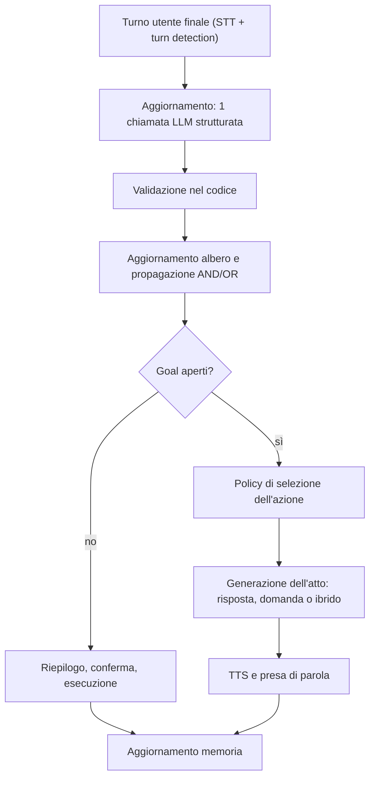

## Obiettivo

Sviluppare un'architettura che permetta a un avatar 3D in Unity di conversare in modo naturale, riconoscere quando qualcuno ha finito di parlare, comprendere le richieste, rispondere, ricordare le interazioni precedenti e prendere l'iniziativa quando mancano informazioni necessarie per completare un compito.

La soluzione non dovrebbe essere soltanto una sequenza STT → LLM → TTS. Per ottenere un avatar realmente interattivo, serve un sistema composto da **percezione, gestione del dialogo, ragionamento, memoria, esecuzione dei task e sincronizzazione con l'animazione**.

## 1. Percezione del parlato

Questa è la prima fase critica: l'avatar deve capire quando qualcuno sta parlando, distinguere il parlato dal rumore e decidere quando è il momento di elaborare una risposta.

Quattro problemi principali:

|Tecnologia|Funzione|
|---|---|
|VAD — Voice Activity Detection|Stabilisce se l'audio contiene parlato.|
|Endpointing / turn detection|Stima quando il turno dell'utente è terminato e si può rispondere.|
|STT — Speech-to-Text|Trasforma il parlato in testo.|
|Speaker identification / diarization _(opzionale)_|Identifica o distingue più parlanti, se il caso d'uso lo richiede.|

Questi compiti appartengono alla pipeline di percezione e gestione audio. Non richiedono la Behavior Tree dell'avatar: possono essere gestiti da Pipecat e dai servizi vocali scelti.

### 1.1 VAD

Un VAD analizza continuamente l'audio e segnala quando inizia o termina un segmento vocale. Può essere utilizzato prima dello STT per evitare di elaborare inutilmente il silenzio.

Tecnologie da valutare:

- **Silero VAD** — [repository ufficiale](https://github.com/snakers4/silero-vad). Modello locale open source pre-addestrato
    - Supporta 8 kHz o 16 kHz
    - Python ([esempi](https://github.com/snakers4/silero-vad/wiki/Examples-and-Dependencies#dependencies))
- **WebRTC VAD** — [implementazione Python](https://github.com/wiseman/py-webrtcvad). Libreria di google. Sembra più configurabile rispetto a Silero
    - 8, 16, 32, 48 kHz
    - python, nodejs, java
- **VAD integrati** nei servizi STT o nelle piattaforme vocali (eg pipecat).

### 1.2 Turn detection

Il VAD si occupa solo di segnalare se in un frammento di audio è presente una voce o meno. Bisogna capire il momento in cui una persona comincia a parlare, e quando smette

La soluzione migliore combina:

- **Silenzio rilevato dal VAD:** segnale iniziale, non decisione definitiva.
- **STT parziale e finale:** aiuta a capire se la frase è completa.
- **Analisi del turno:** valuta se il parlante sembra aver concluso un pensiero.
- **Timeout adattivo:** aspetta più a lungo quando la frase sembra incompleta o quando la latenza dello STT è elevata.
- **Segnali esterni opzionali:** in futuro si potranno considerare eventi provenienti da altri moduli, ma la logica di base deve funzionare senza di essi.

Pipecat è un candidato adatto per orchestrare la pipeline e integrare VAD, STT e strategie di gestione del turno. Va verificato il comportamento concreto del servizio scelto e configurato un solo meccanismo autorevole per stabilire quando avviare la risposta, evitando rilevatori concorrenti non coordinati.

### 1.3 Riconoscimento del parlante _(opzionale)_

Nel caso di una conversazione con un solo interlocutore, il riconoscimento dell'identità non è indispensabile: si può associare la conversazione alla sessione attiva. Se invece devono partecipare più persone, occorre distinguere almeno due problemi:

- **Diarizzazione:** capire quali segmenti audio appartengono allo stesso parlante, senza necessariamente sapere chi sia quella persona.
- **Associazione audio-volto:** collegare un parlante a una persona visibile nella scena, se sono disponibili segnali audiovisivi adeguati.

Al momento, senza un modello per il riconoscimento facciale, si potrebbe semplicemente assegnare un id temporaneo al tracking del volto (il box riconosciuto da opencv). I problemi nascono nel momenti di una sovrapposizione, o quando si esce dall'inquadratura, quindi non è di certo una soluzione definitiva.

### 1.4 Prosody Recognition

Tecnologia che permette di estrarre l'intonazione, il pitch, l'intensità, e quindi in qualche modo capire l'emozione del parlante Tecnologie disponibili (Da controllare se dipendono dalla lingua parlata):

|Tecnologia|Documentazione|Github|Note|
|---|---|---|---|
|openSMILE|https://audeering.github.io/opensmile/|https://github.com/audeering/opensmile||
|SpeechBrain|https://speechbrain.github.io/|https://github.com/speechbrain/speechbrain||
|audEERING devAIce|https://www.audeering.com/||A pagamento|
|Hume AI|https://www.hume.ai/||Si deve fare richiesta per aver accesso alle API. Probabilmente a pagamento|
|Microsoft Foundry|https://learn.microsoft.com/it-it/azure/ai-services/language-service/conversational-language-understanding/quickstart?pivots=rest-api||Ancora non ho capito cosa fa|

## 3. STT e TTS

### 3.1 Servizi da confrontare

> [!info]- Servizi TTS, STT e TTS + STT
> 
> |TTS|STT|Entrambi|
> |---|---|---|
> |[Async](https://async.ai/)|[AssemblyAI](https://www.assemblyai.com/)|[Azure](https://azure.microsoft.com/)|
> |[AWS Polly](https://aws.amazon.com/polly/)|[AWS Transcribe](https://aws.amazon.com/transcribe/)|[Cartesia](https://cartesia.ai/)|
> |[Bland](https://www.bland.ai/)|[Fal Wizper](https://fal.ai/)|[Deepgram](https://deepgram.com/)|
> |[Camb AI](https://www.camb.ai/)|[FunASR](https://github.com/modelscope/FunASR)|[ElevenLabs](https://elevenlabs.io/)|
> |[Deepdub](https://deepdub.ai/)|[Gladia](https://www.gladia.io/)|[Floe](https://floe.ai/)|
> |[Fish](https://fish.audio/)|[Gnani](https://www.gnani.ai/)|[Google](https://cloud.google.com/)|
> |[Gandr](https://gandr.ai/)|[Gradium](https://gradium.ai/)|[Groq](https://groq.com/)|
> |[Hume](https://www.hume.ai/)|[Hakim](https://hakim.ai/)|[Mistral](https://mistral.ai/)|
> |[Inworld](https://inworld.ai/)|[Meta](https://ai.meta.com/)|[NVIDIA](https://www.nvidia.com/)|
> |[Kokoro](https://github.com/hexgrad/kokoro)|[Moonshine](https://github.com/moonshine-ai/moonshine)|[OpenAI](https://openai.com/)|
> |[Lokutor](https://lokutor.com/)|[Oruk](https://oruk.ai/)|[Together AI](https://www.together.ai/)|
> |[Maya](https://maya.ai/)|[Quickdial](https://quickdial.ai/)||
> |[MiniMax](https://www.minimax.io/)|[Ringg AI](https://ringg.ai/)||
> |[Murf AI](https://murf.ai/)|[Sarvam](https://www.sarvam.ai/)||
> |[Neuphonic](https://neuphonic.com/)|[Simplismart](https://simplismart.ai/)||
> |Pipecat TTS Cache|[SLNG](https://slng.ai/)||
> |[Piper](https://github.com/rhasspy/piper)|[Smallest](https://smallest.ai/)||
> |[Pocket TTS](https://github.com/kyutai-labs/pocket-tts)|[Soniox](https://soniox.com/)||
> |[Resemble AI](https://www.resemble.ai/)|[Speechmatics](https://www.speechmatics.com/)||
> |[Respeecher](https://www.respeecher.com/)|[Uplift AI](https://upliftai.org/)||
> |[Rime](https://rime.ai/)|[Whisper](https://github.com/openai/whisper)||
> |[Rumik AI](https://rumik.ai/)|||
> |[SILMA AI](https://silma.ai/)|||
> |[SonexLabs](https://sonexlabs.com/)|||
> |[Speechify](https://speechify.com/)|||
> |[Supertonic](https://github.com/supertone-inc/supertonic)|||
> |[Typecast](https://typecast.ai/)|||
> |[Uplift AI](https://upliftai.org/)|||
> |[Vakyam AI](https://vakyam.ai/)|||
> |[Voice.ai](https://voice.ai/)|||
> |[XTTS](https://github.com/coqui-ai/TTS)|||
> |[XTTS-vLLM](https://github.com/erew123/alltalk_tts)|||

## 4. LLM

Il modello linguistico non deve limitarsi a ricevere una trascrizione e restituire una frase. Deve decidere quale sia il prossimo passo della conversazione.

Le responsabilità principali sono:

- Interpretare l'intento dell'utente.
- Risolvere riferimenti al contesto precedente.
- Consultare la memoria pertinente.
- Verificare se la richiesta è sufficientemente specificata.
- Decidere se rispondere, chiedere chiarimenti, eseguire un'azione o rifiutare una richiesta.
- Generare una risposta coerente con il ruolo dell'avatar.

### 4.1 Ruoli configurabili dell'avatar

Per supportare un aiutante, un moderatore o un tutor, si può usare una configurazione che definisce:

- Istruzioni e personalità.
- Obiettivi e compiti consentiti.
- Tono e livello di formalità.
- Regole per fare domande.
- Strumenti disponibili.
- Politiche di memoria.
- Voce e stile di animazione.

In questo modo il comportamento cambia tramite configurazione, mentre la pipeline rimane la stessa.

## 5. Goal manager: gestione dei compiti e iniziativa

Il Goal manager è il modulo che permette all'avatar di sapere **cosa gli manca** per completare un compito e di decidere **quando e cosa chiedere**. Senza questo modulo l'LLM tende a rispondere comunque, inventando i valori che non ha (dati del task, argomenti delle funzioni). Con il Goal manager lo stato del compito è esterno all'LLM, esplicito e controllabile dal codice.

Come la percezione del parlato, è logica di dialogo: vive nel server Pipecat e non richiede la BT. Verso l'animazione escono solo eventi semantici (es. `asking_question`, vedi 8.2).

### 5.1 Riferimento teorico

Paper: Badagliacca, Caruso, Augello, Sabatucci, _Graph of Goal-Oriented Thoughts: Design and Implementation of LLM Agents_ (CNR-ICAR, workshop ACM IUI 2025). Si basa sul paradigma _Graph of Thoughts_ (Besta et al., AAAI 2024). Il codice dichiarato dagli autori è in [ls-cnr/MIRA](https://github.com/ls-cnr/MIRA) _(da controllare: licenza e manutenzione)_.

Idee principali:

- **Goal model:** albero che scompone un goal radice in sotto-goal, con legami **AND** (servono tutti i figli) e **OR** (basta un figlio).
- **Goal epistemici:** obiettivi del tipo «sapere qualcosa» dall'utente. Sono quelli che governano le domande dell'avatar.
- **Tre aree funzionali:**

|Area|Funzione|
|---|---|
|User Manager|Estrae dal turno dell'utente le informazioni relative ai goal e le salva in una memoria persistente (User Knowledge).|
|Epistemic Goal Manager|Verifica lo stato di ogni goal e compila la lista dei goal non soddisfatti.|
|Dialogue Manager|Genera una risposta reattiva e un atto proattivo per ogni goal aperto, li valuta e sceglie il migliore.|

- **Atti proattivi:** rispondere, chiedere un chiarimento, oppure rispondere e chiedere insieme (risposta ibrida).
- **Ipotesi più conferma:** l'agente può dedurre un goal dalle parole dell'utente, ma lo chiude solo dopo la conferma.

> [!warning]- Limiti del paper È un workshop paper con un solo esempio illustrativo (agente di viaggio) e nessuna valutazione quantitativa. Gli autori lasciano aperti la granularità dei passi di ragionamento, l'equilibrio tra struttura e conversazione naturale e la scalabilità. Non riporta latenze né costi. Va quindi usato come **modello di progetto**, non come soluzione validata.

### 5.2 Cosa teniamo e cosa cambiamo

|Aspetto|Paper|Nostra scelta|Motivo|
|---|---|---|---|
|Struttura|Albero AND/OR con stati soddisfatto, parziale, non soddisfatto|Uguale, più gli stati `hypothesis` e `conflict`|L'utente può cambiare idea o essere dedotto|
|Estrazione e verifica|Una chiamata LLM per goal, per ciascuna fase|**Una sola chiamata strutturata per turno**, su tutti i goal aperti|Latenza: per la voce non è sostenibile|
|Scelta della domanda|Un atto per ogni goal aperto, punteggio LLM (alto, medio, basso), poi KeepBest|**Regola deterministica nel codice**; l'LLM formula soltanto la frase|Prevedibilità e latenza|
|Tipi di goal|Solo epistemici (cita funzionali e qualità)|Epistemici più goal di esecuzione (task)|Serve anche eseguire azioni|
|Conferma|Conferma al turno successivo|Come il paper, più **conferma esplicita** prima delle azioni irreversibili|Sicurezza|
|Voce|Non trattata|Integrato con turn detection e interruzioni|Vedi 1.2 e 7.2|

### 5.3 Modello dei dati

Ogni nodo dell'albero ha:

|Campo|Descrizione|
|---|---|
|`id`, `nome`|Identificatore e nome del goal.|
|`tipo`|`epistemic`, `functional` o `quality`.|
|`legame`|`AND`, `OR` o foglia.|
|`stato`|Vedi tabella sotto.|
|`valore`|Per le foglie epistemiche: il dato raccolto.|
|`evidenza`|Turno e frase dell'utente da cui è stato ricavato il valore.|
|`confidenza`|Affidabilità dell'estrazione (include l'incertezza dello STT).|
|`obbligatorio`, `bloccante`, `priorita`|Usati dalla policy di selezione (5.5).|
|`validatore`|Regola di validità: tipo, intervallo, vocabolario, formato data/ora.|
|`default`|Valore opzionale se l'utente non risponde.|

Stati di un goal:

|Stato|Significato|
|---|---|
|`unsatisfied`|Nessuna informazione disponibile.|
|`hypothesis`|Valore dedotto o preso dalla memoria, non ancora confermato dall'utente.|
|`partial`|Alcuni figli soddisfatti, altri no.|
|`satisfied`|Valore fornito o confermato e valido.|
|`conflict`|Nuove informazioni contraddicono un valore già registrato.|
|`negated`|L'utente rifiuta esplicitamente il goal («non voglio X»). Il paper lo tratta come goal completato.|
|`skipped`|Superato il numero massimo di tentativi: si usa il default o si prosegue senza.|

Propagazione (deterministica, nel codice): un nodo AND è soddisfatto quando **tutti** i figli lo sono, un nodo OR quando **almeno uno** lo è. Un figlio in `conflict` rende il padre `partial`.

Esempio di goal model (task «prenotare una sala»):

```yaml
goal: prenota_sala             # radice, legame AND
tipo: functional
figli:
  - goal: quando               # AND
    figli:
      - {goal: data, tipo: epistemic, obbligatorio: true, validatore: data_futura}
      - {goal: ora_inizio, tipo: epistemic, obbligatorio: true, validatore: orario}
      - {goal: durata, tipo: epistemic, obbligatorio: false, default: 60min}
  - {goal: partecipanti, tipo: epistemic, obbligatorio: true, validatore: intero_1_50}
  - goal: dotazione            # OR
    figli:
      - {goal: proiettore, tipo: epistemic}
      - {goal: videoconferenza, tipo: epistemic}
      - {goal: nessuna, tipo: epistemic}
```

I goal model vengono definiti in configurazione (file YAML o JSON) e caricati dal ruolo attivo (vedi 5.8).

### 5.4 Ciclo di elaborazione per turno



1. **Ingresso:** trascrizione finale del turno, stato attuale dell'albero, ultima domanda posta dall'avatar (se si era in attesa di risposta) e memoria pertinente (profilo, task sospesi).
2. **Chiamata LLM strutturata** (schema JSON o function calling) che restituisce:
    - tipo di turno: `risposta_a_domanda`, `domanda`, `nuovo_compito`, `modifica`, `annullamento`, `altro`;
    - per ogni goal aperto: valore estratto, frase di evidenza, stato proposto (`fornito`, `ipotesi`, `negato`, `conflitto`, `nessuno`), confidenza.
3. **Validazione nel codice:**
    - il tipo e il valore passano il `validatore`;
    - la frase di evidenza deve comparire davvero nel turno dell'utente. Se no, il valore non viene registrato. _(Controllo proposto da noi per limitare i valori inventati)_;
    - un valore dedotto e non detto esplicitamente resta `hypothesis`.
4. **Aggiornamento dell'albero** e propagazione AND/OR.
5. **Policy di selezione** dell'azione successiva (5.5).
6. **Generazione dell'atto:** l'LLM riceve il tipo di atto e il goal da trattare e produce soltanto la frase, in streaming verso il TTS (vedi 7.1).
7. **Aggiornamento della memoria** (5.8).

Se il turno è una domanda non legata ai goal, l'avatar risponde prima in modo reattivo. Può poi aggiungere una domanda proattiva (risposta ibrida) se la policy lo consente.

### 5.5 Policy di selezione della domanda

Regole applicate in ordine, tutte nel codice:

1. Se l'utente ha fatto una domanda, rispondere prima (risposta reattiva).
2. Se c'è un goal in `conflict`, chiedere di risolverlo.
3. Se c'è una `hypothesis` rilevante, chiedere conferma inserendola nella frase.
4. Altrimenti scegliere il primo goal obbligatorio non soddisfatto tra le foglie sbloccate, ordinando per: bloccante, dipendenze, priorità definita in configurazione.
5. Per un ramo OR non elencare tutte le alternative: fare una domanda aperta oppure proporre al massimo due o tre opzioni.
6. **Una sola domanda per turno.** Si accorpano solo goal strettamente legati (es. data e ora).
7. Non chiedere ciò che è già in memoria: proporlo come ipotesi.
8. Numero massimo di tentativi per goal; superato il limite si passa a `skipped`.
9. Utente non collaborativo (rifiuta, devia): riformulare una volta, poi sospendere il task invece di insistere.

Tipi di atto:

|Atto|Quando|Esempio|
|---|---|---|
|Risposta|L'utente ha fatto una domanda|«La sala grande ha il proiettore.»|
|Domanda|Manca un goal obbligatorio|«Per che giorno ti serve la sala?»|
|Ibrido|Si risponde e si chiede nello stesso turno|«Il proiettore c'è. Quante persone parteciperanno?»|
|Conferma|C'è una `hypothesis` o un `conflict`|«Quindi sempre alle 10, come l'altra volta?»|
|Riepilogo|Tutti i goal obbligatori sono soddisfatti|«Ricapitolo: giovedì, ore 10, 8 persone. Confermo?»|

### 5.6 Presa di parola

Quando l'avatar può parlare:

- **Risposta reattiva o domanda legata al turno:** solo dopo la fine turno confermata dal meccanismo autorevole di turn detection (1.2). Mai sopra l'utente.
- **Iniziativa spontanea** (promemoria, timeout, interventi da moderatore): solo se l'utente non sta parlando e dopo una pausa minima. Prima si invia l'evento alla BT (`asking_question`, sguardo verso la persona), poi si parla. L'intervento deve poter essere interrotto.

Stati del dialogo: `Idle`, `Listening`, `Thinking`, `Speaking`, `AskingQuestion`, `WaitingForAnswer`.

- In `WaitingForAnswer` il turno successivo viene interpretato **prima** come risposta al goal chiesto. È il principio delle coppie adiacenti domanda-risposta, ripreso in _Who Speaks Next?_ ([arXiv 2412.04937](https://arxiv.org/abs/2412.04937)). La classificazione resta comunque all'LLM: l'utente può rispondere con un'altra domanda.
- Timeout: una sola ripetizione, poi il task passa a `suspended`.
- **Interruzione** (7.2): se l'avatar viene interrotto mentre fa una domanda, il goal resta aperto e conta come chiesto solo la parte realmente pronunciata.

### 5.7 Ciclo di vita dei compiti

Il Goal manager gestisce anche l'esecuzione, che il paper non copre.

|Stato del task|Significato|
|---|---|
|`collecting`|Ci sono goal obbligatori aperti: si fanno domande.|
|`confirming`|Tutti i goal obbligatori sono soddisfatti: riepilogo e conferma. La conferma esplicita è obbligatoria per azioni irreversibili o con effetti esterni.|
|`executing`|Invocazione dello strumento registrato per il ruolo, con timeout e idempotenza.|
|`done`|Eseguito. Esito registrato in memoria.|
|`failed`|Errore: si comunica e si offre di riprovare o modificare i dati.|
|`suspended`|L'utente ha cambiato argomento o non risponde. Riprendibile.|
|`cancelled`|Annullato dall'utente.|

Più compiti in parallelo: una lista di task con priorità, **un solo task attivo** nel dialogo, gli altri sospesi. Per riprendere un task sospeso l'avatar lo propone esplicitamente («Prima stavamo prenotando la sala, vuoi continuare?»).

### 5.8 Integrazione con ruoli, memoria e animazione

**Ruoli (4.1).** La configurazione del ruolo include i goal model disponibili e i parametri della policy:

|Ruolo|Proattività|Goal model|
|---|---|---|
|Assistente|Bassa: risponde, chiede solo il necessario|Pochi task semplici|
|Aiutante|Media: esegue compiti e chiede i dati mancanti|Task con strumenti|
|Moderatore|Alta: gestisce turni e tempi|Agenda della sessione|

**Moderatore.** L'albero può rappresentare l'agenda: goal come «ogni partecipante ha espresso un'opinione su X», «decisione presa su Y», «tempo rimasto». Lo stato si aggiorna dal contenuto dei turni, quindi richiede l'attribuzione del parlante (1.3). _Idea nostra, non presente nel paper e da validare._

**Memoria (6).**

|Memoria|Uso nel Goal manager|
|---|---|
|Working|Albero e stato del task corrente.|
|Episodica|Task sospesi o incompleti, esiti dei task, così sopravvivono alla sessione.|
|Semantica e profilo|Valori stabili (lingua, preferenze, dati ricorrenti) che pre-compilano i goal come `hypothesis`.|

Con Hindsight (6.2): `recall` prima dell'aggiornamento per pre-compilare i goal, `retain` a fine turno o a fine task in modo asincrono, fuori dal percorso critico della latenza.

**Animazione (8.2).** Il Goal manager emette eventi semantici verso il controller visivo: `thinking` durante l'aggiornamento, `asking_question` prima di una domanda, `confirming` durante i riepiloghi.

### 5.9 Implementazione in Pipecat

Il nucleo (albero, validatori, propagazione, policy) va scritto come **libreria Python indipendente da Pipecat**, testabile con trascrizioni registrate e senza audio. L'adattatore verso Pipecat è sottile e ci sono due strade:

|Opzione|Descrizione|Pro|Contro|
|---|---|---|---|
|**A. Processore personalizzato**|Un `FrameProcessor` tra l'aggregatore del turno utente e l'LLM. Mantiene l'albero, fa la chiamata strutturata, decide l'atto e inserisce nel contesto le istruzioni per il turno.|Controllo totale, una sola chiamata di estrazione, indipendente dal function calling del modello|Da scrivere da zero|
|**B. Pipecat Flows**|Add-on open source per conversazioni strutturate: nodi con messaggi di ruolo e di task, funzioni di nodo e di transizione, stato condiviso (`flow_manager.state`), flussi dinamici con `transition_callback`. Un nodo per goal aperto: una funzione `fill_goal` valida e aggiorna l'albero, la callback sceglie il nodo successivo con la policy di 5.5.|Gestione del contesto e delle transizioni già pronta, editor visuale|L'estrazione passa dal function calling: va testata l'affidabilità con LLM locali piccoli. Il rischio è una conversazione rigida|

Riferimenti: [guida a Pipecat Flows](https://docs.pipecat.ai/guides/features/pipecat-flows), [API di Pipecat Flows](https://docs.pipecat.ai/server/frameworks/flows/pipecat-flows).

Altri strumenti utili:

|Tecnologia|Funzione|
|---|---|
|Libreria di validazione (es. Pydantic)|Schemi di goal, valori e output dell'LLM.|
|Output strutturato del runtime LLM|JSON schema o grammatiche per forzare il formato (da verificare sul runtime scelto).|
|Pipecat Flows|Opzionale, vedi opzione B.|

### 5.10 Latenza

Nel paper ogni goal richiede chiamate separate (estrazione, verifica, atto proattivo, punteggio): con la voce il costo si somma a STT e TTS. La nostra versione usa:

1. una chiamata di **estrazione** con output breve e strutturato (possibile un modello più piccolo);
2. la policy nel codice (tempo trascurabile);
3. una chiamata di **generazione** in streaming verso il TTS.

I numeri vanno misurati sul nostro hardware, fase per fase. Durante l'elaborazione l'avatar mostra `thinking`, così l'attesa non sembra un blocco.

### 5.11 Valutazione

Metriche:

- Task completati e numero di turni per completarli.
- Domande inutili o ripetute (sovra-richiesta).
- Valori inventati: goal riempiti senza evidenza nel turno.
- Correttezza dello stato dell'albero dopo ogni turno.
- Latenza per fase.

Test:

- **Unit test** dell'albero (propagazione AND/OR, `conflict`, `negated`) senza LLM.
- Conversazioni scriptate e utente simulato da LLM, anche non collaborativo.
- Prove in italiano e con parlato reale, per includere gli errori dello STT.
- Benchmark pubblici sulle domande di chiarimento da adattare: ClarifyMT-Bench ([arXiv 2512.21120](https://arxiv.org/abs/2512.21120)), ClarQ-LLM ([arXiv 2409.06097](https://arxiv.org/abs/2409.06097)), ClarifyBench in _Structured Uncertainty guided Clarification_ ([arXiv 2511.08798](https://arxiv.org/abs/2511.08798)).

### 5.12 Punti aperti

- Granularità dell'albero: troppi goal portano a troppe domande.
- Errori dello STT che riempiono o contraddicono un goal: servono confidenza e conferma per i valori critici (nomi, numeri, date).
- Più persone: a chi appartiene il valore? Dipende dall'attribuzione del parlante (1.3).
- Qualità dei prompt di estrazione in italiano: da provare.
- Licenza e stato di manutenzione di MIRA.

### 5.13 Riferimenti

|Fonte|Link|
|---|---|
|Badagliacca et al., _Graph of Goal-Oriented Thoughts_ (ACM IUI Workshops 2025)|[Codice: ls-cnr/MIRA](https://github.com/ls-cnr/MIRA)|
|Besta et al., _Graph of Thoughts_ (AAAI 2024)|[arXiv 2308.09687](https://arxiv.org/abs/2308.09687)|
|Deng et al., _Prompting and evaluating LLMs for proactive dialogues_|[arXiv 2305.13626](https://arxiv.org/abs/2305.13626)|
|_Who Speaks Next?_ Multi-party AI discussion|[arXiv 2412.04937](https://arxiv.org/abs/2412.04937)|
|Pipecat Flows|[Guida](https://docs.pipecat.ai/guides/features/pipecat-flows)|

## 6. Memoria: come permettere all'avatar di ricordare le conversazioni

### 6.1 Quattro forme di memoria

#### 1. Working memory

Mantiene lo stato della conversazione corrente e le informazioni necessarie per il turno in corso. Esempi: la domanda appena posta, il nome citato dall'utente, il campo mancante di un task, il punto in cui si è interrotta una risposta.

#### 2. Episodic memory

Conserva eventi e interazioni specifiche. Esempi: «Nella sessione precedente abbiamo configurato la connessione WebSocket» oppure «L'utente ha chiesto di riprendere il task rimasto incompleto».

#### 3.Semantic memory

Conserva informazioni sintetiche, fatti e conoscenze ricavate dalle interazioni. Esempi: «Il progetto utilizza Unity» oppure «L'avatar deve attendere il segnale di fine turno della BT».

#### 4. Memoria di preferenze e profilo

Contiene preferenze persistenti, obiettivi e impostazioni personali consentite. Esempi: ruolo default dell'avatar, stile delle risposte, lingua, modalità di interazione e preferenze esplicitamente comunicate.

### 6.2 Tecnologie

#### Hindsight

[GitHub](https://github.com/vectorize-io/hindsight?aid=recisxiRbc53vkTs9) [Documentazione](https://docs.hindsight.vectorize.io)

Open Source. L'architettura comprende estrazione delle informazioni, recupero contestuale, relazioni tra entità, ragionamento temporale e aggiornamento delle conoscenze. Tecnologia più adatta e completa per il nostro caso

Altre opzioni:

#### Mem0

- Sito: [Mem0](https://mem0.ai)
- Documentazione e codice: [Repository e documentazione open source](https://github.com/mem0ai/mem0/blob/main/docs/open-source/overview.mdx)

#### Graphiti

- Sito ufficiale: [Graphiti e Zep](https://www.getzep.com/platform/graphiti)
- Documentazione: [Documentazione di Graphiti](https://help.getzep.com/v2/graphiti/getting-started/overview)

#### LangMem

- Documentazione: [LangMem](https://langchain-ai.github.io/langmem)
- Annuncio e panoramica tecnica: [LangMem SDK](https://www.langchain.com/blog/langmem-sdk-launch)

## 7. TTS

### 7.1 Streaming e latenza

La soluzione migliore per una conversazione in tempo reale è generalmente evitare di aspettare che l'LLM produca l'intera risposta.

La pipeline può funzionare così:

1. L'LLM genera il primo segmento di testo.
2. Il TTS inizia a sintetizzarlo.
3. L'audio viene inviato a Unity.
4. Mentre l'avatar parla, l'LLM continua a generare il resto.
5. I segmenti successivi vengono riprodotti in sequenza.

Pipecat supporta modalità di aggregazione del testo per il TTS, tra cui l'aggregazione per frase e quella per token.

### 7.2 Il problema delle interruzioni

Se l'utente inizia a parlare mentre l'avatar sta rispondendo, la pipeline dovrebbe poter:

- Interrompere la generazione del testo.
- Cancellare o invalidare i segmenti audio non ancora riprodotti.
- Svuotare le code audio di Unity.
- Registrare nella cronologia soltanto la parte della risposta realmente pronunciata.
- Passare allo stato di ascolto.

Per evitare interruzioni involontarie dovute a rumore o brevi vocalizzazioni, si possono prevedere soglie e regole di conferma. Pipecat dispone di meccanismi per la gestione delle interruzioni e per la propagazione dei relativi eventi.

## 8. Collegare la voce all'avatar

### 8.1 Lip-sync

[plugin unity](https://github.com/hecomi/uLipSync)

### 8.2 Gesti, espressioni e sguardo

Si può aggiungere un controller visivo separato che riceva eventi semantici dal server. In prima battuta può aggiornare direttamente lip-sync, sguardo, espressioni e gesti semplici

Esempi:

- `listening` → sguardo rivolto al parlante e postura di ascolto.
- `thinking` → breve pausa e movimento discreto dello sguardo.
- `asking_question` → espressione interrogativa.
- `explaining` → gesti illustrativi.
- `confirming` → cenno del capo.
- `interrupted` → arresto del parlato e ritorno all'ascolto.