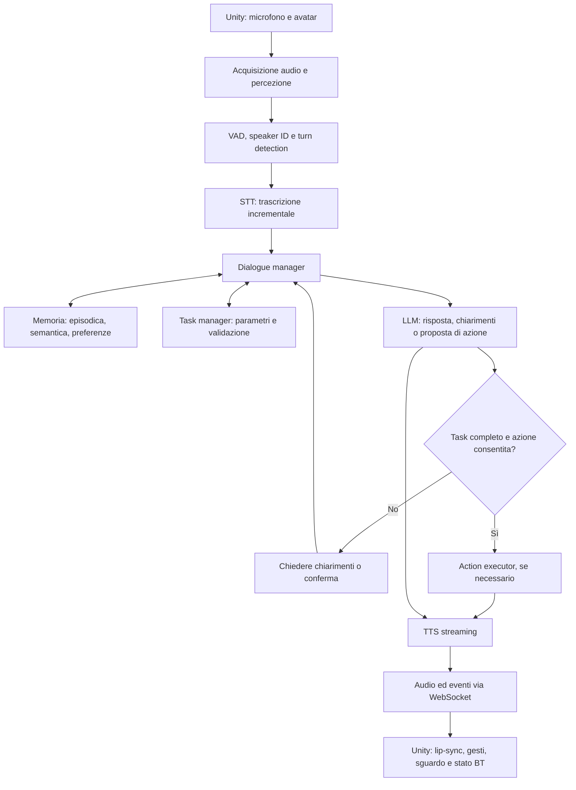
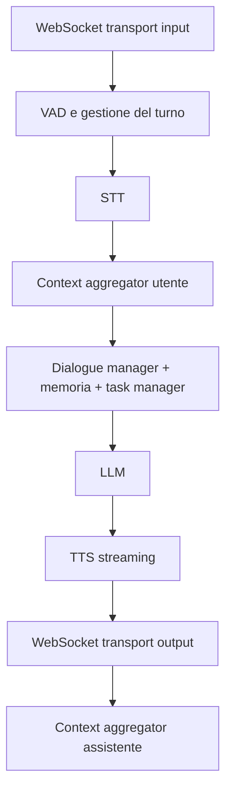

## Obiettivo

Sviluppare un'architettura che permetta a un avatar 3D in Unity di conversare in modo naturale, riconoscere quando qualcuno ha finito di parlare, comprendere le richieste, rispondere, ricordare le interazioni precedenti e prendere l'iniziativa quando mancano informazioni necessarie per completare un compito.

La soluzione non dovrebbe essere soltanto una sequenza STT → LLM → TTS. Per ottenere un avatar realmente interattivo, serve un sistema composto da **percezione, gestione del dialogo, ragionamento, memoria, esecuzione dei task e sincronizzazione con l'animazione**.

## 1. Architettura complessiva



L'architettura è divisa in due ambienti:

- **Unity:** microfono, avatar, animazione, interfaccia e coordinamento con la Behavior Tree.
- **Server conversazionale:** Pipecat, STT, LLM, memoria, task manager e TTS.

La comunicazione fra i due può avvenire via WebSocket. Il server può inviare eventi strutturati a Unity, oltre all'audio, così che l'avatar sappia se sta ascoltando, pensando, parlando, chiedendo chiarimenti o eseguendo un'azione.

## 2. Percezione del parlato: dal microfono alla fine del turno

Questa è la prima fase critica: l'avatar deve capire quando qualcuno sta parlando, distinguere il parlato dal rumore e decidere quando è il momento di elaborare una risposta.

Quattro problemi principali:

| Tecnologia                           | Funzione                                         |
| ------------------------------------ | ------------------------------------------------ |
| VAD — Voice Activity Detection       | Stabilisce se l'audio contiene parlato.          |
| Endpointing / turn detection         | Stabilisce se il parlante ha terminato il turno. |
| STT — Speech-to-Text                 | Trasforma il parlato in testo.                   |
| Speaker identification / diarization | Identifica il parlante o distingue più parlanti. |
Oltre alle soluzioni elencate di seguito, i problemi si potrebbero associare al Behaviour Tree già costruito per l'avatar
### 2.1 VAD: rilevare la presenza di parlato

Un VAD analizza continuamente l'audio e segnala quando inizia o termina un segmento vocale. Può essere utilizzato prima dello STT per evitare di elaborare inutilmente il silenzio.

Tecnologie da valutare:

- **Silero VAD** — [repository ufficiale](https://github.com/snakers4/silero-vad). Modello locale open source pre-addestrato
	- Supporta 8 kHz o 16 kHz
	- Python ([esempi](https://github.com/snakers4/silero-vad/wiki/Examples-and-Dependencies#dependencies))
- **WebRTC VAD** — [implementazione Python](https://github.com/wiseman/py-webrtcvad). Libreria di google. Sembra più configurabile rispetto a Silero
	- 8, 16, 32, 48 kHz
	- python, nodejs, java
- **VAD integrati** nei servizi STT o nelle piattaforme vocali (eg pipecat).

### 2.2 Turn detection: capire quando rispondere

Il VAD si occupa solo di segnalare se in un frammento di audio è presente una voce o meno. Bisogna capire il momento in cui una persona comincia a parlare, e quando smette

La soluzione migliore combina:

- **Silenzio rilevato dal VAD:** segnale iniziale, non decisione definitiva.
- **STT parziale e finale:** aiuta a capire se la frase è completa.
- **Analisi del turno:** valuta se il parlante sembra aver concluso un pensiero.
- **Timeout adattivo:** aspetta più a lungo quando la frase sembra incompleta o quando la latenza dello STT è elevata.
- **Segnali della Behavior Tree:** utilizzano la decisione già presa dal sistema esistente.

Anche qui Pipecat sembra la strada migliore, avendo molte delle strategie di sopra già integrate, configurabili anche con proprie regole 

### 2.3 Riconoscimento del parlante

Il Behviour tree, anche se sviluppato per far muovere il modello potrebbe in qualche modo dare sei segnali relativi a chi e quando sta parlando.
Qua sto solo ipotizzando, non conoscendone nel dettaglio il funzionamento. Finchè una persona non esce dall'inquadratura, il box che opencv assegna ad una faccia rimane sempre lo stesso, quindi si potrebbe assegnare un id? E taggare la conversazione con Persona1 o Persona2

### 2.4 Prosody Recognition
Tecnologia che permette di estrarre l'intonazione, il pitch, l'intensità, e quindi in qualche modo capire l'emozione del parlante
Tecnologie disponibili (Da controllare se dipendono dalla lingua parlata):

| Tecnologia        | Documentazione                                                                                                                        | Github                                     | Note                                                                        |
| ----------------- | ------------------------------------------------------------------------------------------------------------------------------------- | ------------------------------------------ | --------------------------------------------------------------------------- |
| openSMILE         | https://audeering.github.io/opensmile/                                                                                                | https://github.com/audeering/opensmile     |                                                                             |
| SpeechBrain       | https://speechbrain.github.io/                                                                                                        | https://github.com/speechbrain/speechbrain |                                                                             |
| audEERING devAIce | https://www.audeering.com/                                                                                                            |                                            | A pagamento                                                                 |
| Hume AI           | https://www.hume.ai/                                                                                                                  |                                            | Si deve fare richiesta per aver accesso alle API. Probabilmente a pagamento |
| Microsoft Foundry | https://learn.microsoft.com/it-it/azure/ai-services/language-service/conversational-language-understanding/quickstart?pivots=rest-api |                                            | Ancora non ho capito cosa fa                                                |

## 3. STT e TTS

### 3.1 Servizi da confrontare
> [!info]- Servizi TTS, STT e TTS + STT
>
> | TTS | STT | Entrambi |
> |---|---|---|
> | [Async](https://async.ai/) | [AssemblyAI](https://www.assemblyai.com/) | [Azure](https://azure.microsoft.com/) |
> | [AWS Polly](https://aws.amazon.com/polly/) | [AWS Transcribe](https://aws.amazon.com/transcribe/) | [Cartesia](https://cartesia.ai/) |
> | [Bland](https://www.bland.ai/) | [Fal Wizper](https://fal.ai/) | [Deepgram](https://deepgram.com/) |
> | [Camb AI](https://www.camb.ai/) | [FunASR](https://github.com/modelscope/FunASR) | [ElevenLabs](https://elevenlabs.io/) |
> | [Deepdub](https://deepdub.ai/) | [Gladia](https://www.gladia.io/) | [Floe](https://floe.ai/) |
> | [Fish](https://fish.audio/) | [Gnani](https://www.gnani.ai/) | [Google](https://cloud.google.com/) |
> | [Gandr](https://gandr.ai/) | [Gradium](https://gradium.ai/) | [Groq](https://groq.com/) |
> | [Hume](https://www.hume.ai/) | [Hakim](https://hakim.ai/) | [Mistral](https://mistral.ai/) |
> | [Inworld](https://inworld.ai/) | [Meta](https://ai.meta.com/) | [NVIDIA](https://www.nvidia.com/) |
> | [Kokoro](https://github.com/hexgrad/kokoro) | [Moonshine](https://github.com/moonshine-ai/moonshine) | [OpenAI](https://openai.com/) |
> | [Lokutor](https://lokutor.com/) | [Oruk](https://oruk.ai/) | [Together AI](https://www.together.ai/) |
> | [Maya](https://maya.ai/) | [Quickdial](https://quickdial.ai/) | |
> | [MiniMax](https://www.minimax.io/) | [Ringg AI](https://ringg.ai/) | |
> | [Murf AI](https://murf.ai/) | [Sarvam](https://www.sarvam.ai/) | |
> | [Neuphonic](https://neuphonic.com/) | [Simplismart](https://simplismart.ai/) | |
> | Pipecat TTS Cache | [SLNG](https://slng.ai/) | |
> | [Piper](https://github.com/rhasspy/piper) | [Smallest](https://smallest.ai/) | |
> | [Pocket TTS](https://github.com/kyutai-labs/pocket-tts) | [Soniox](https://soniox.com/) | |
> | [Resemble AI](https://www.resemble.ai/) | [Speechmatics](https://www.speechmatics.com/) | |
> | [Respeecher](https://www.respeecher.com/) | [Uplift AI](https://upliftai.org/) | |
> | [Rime](https://rime.ai/) | [Whisper](https://github.com/openai/whisper) | |
> | [Rumik AI](https://rumik.ai/) | | |
> | [SILMA AI](https://silma.ai/) | | |
> | [SonexLabs](https://sonexlabs.com/) | | |
> | [Speechify](https://speechify.com/) | | |
> | [Supertonic](https://github.com/supertone-inc/supertonic) | | |
> | [Typecast](https://typecast.ai/) | | |
> | [Uplift AI](https://upliftai.org/) | | |
> | [Vakyam AI](https://vakyam.ai/) | | |
> | [Voice.ai](https://voice.ai/) | | |
> | [XTTS](https://github.com/coqui-ai/TTS) | | |
> | [XTTS-vLLM](https://github.com/erew123/alltalk_tts) | | |
> 


## 4. LLM: comprensione, ragionamento e gestione del dialogo

Il modello linguistico non deve limitarsi a ricevere una trascrizione e restituire una frase. Deve decidere quale sia il prossimo passo della conversazione.

Le responsabilità principali sono:

- Interpretare l'intento dell'utente.
- Risolvere riferimenti al contesto precedente.
- Consultare la memoria pertinente.
- Verificare se la richiesta è sufficientemente specificata.
- Decidere se rispondere, chiedere chiarimenti, eseguire un'azione o rifiutare una richiesta.
- Generare una risposta coerente con il ruolo dell'avatar.

### 4.1 Ruoli configurabili dell'avatar

Per supportare un aiutante, un moderatore o un tutor, si può usare una configurazione che definisce:

- Istruzioni e personalità.
- Obiettivi e compiti consentiti.
- Tono e livello di formalità.
- Regole per fare domande.
- Strumenti disponibili.
- Politiche di memoria.
- Voce e stile di animazione.

In questo modo il comportamento cambia tramite configurazione, mentre la pipeline rimane la stessa.

## 5. Chiedere informazioni mancanti

### 5.4 Quando chiedere chiarimenti e quando assumere un valore predefinito

Non tutte le informazioni mancanti richiedono una domanda. Il sistema dovrebbe classificare i dati in tre categorie:

- **Obbligatori:** senza questi dati il task non può essere completato.
- **Facoltativi:** possono essere omessi senza compromettere il risultato.
- **Inferibili:** possono essere ricavati dal contesto o dalla memoria, purché la confidenza sia sufficiente.

Il lavoro **“Clarify When Necessary: Resolving Ambiguity Through Interaction with LMs”** (NAACL 2025) studia come i modelli possano risolvere ambiguità interagendo con l'utente: [articolo scientifico](https://aclanthology.org/2025.findings-naacl.306/).

1. Verificare la completezza dei dati.
2. Valutare se esiste un valore predefinito sicuro.
3. Recuperare eventuali informazioni pertinenti dalla memoria.
4. Chiedere una precisazione se resta un'incertezza rilevante.
5. Confermare i dati prima delle operazioni importanti.

## 6. Memoria: come permettere all'avatar di ricordare le conversazioni

Un LLM, da solo, non costituisce un sistema di memoria persistente. La cronologia può essere passata al modello come contesto, ma ciò non garantisce che le informazioni restino disponibili nelle sessioni successive né che vengano recuperate correttamente.

Conviene progettare una memoria esterna, con criteri di scrittura, recupero, aggiornamento e cancellazione.

### 6.1 Le quattro forme di memoria

#### 1. Memoria di lavoro — Working memory

Mantiene lo stato della conversazione corrente e le informazioni necessarie per il turno in corso.
Esempi: la domanda appena posta, il nome citato dall'utente, il campo mancante di un task, il punto in cui si è interrotta una risposta.

#### 2. Memoria episodica — Episodic memory

Conserva eventi e interazioni specifiche.
Esempi: «Nella sessione precedente abbiamo configurato la connessione WebSocket» oppure «L'utente ha chiesto di riprendere il task rimasto incompleto».

#### 3. Memoria semantica — Semantic memory

Conserva informazioni sintetiche, fatti e conoscenze ricavate dalle interazioni.
Esempi: «Il progetto utilizza Unity» oppure «L'avatar deve attendere il segnale di fine turno della BT».

#### 4. Memoria di preferenze e profilo

Contiene preferenze persistenti, obiettivi e impostazioni personali consentite.
Esempi: ruolo default dell'avatar, stile delle risposte, lingua, modalità di interazione e preferenze esplicitamente comunicate.

### 6.2 Riferimenti scientifici fondamentali

**Generative Agents: Interactive Simulacra of Human Behavior** — Park et al., UIST 2023.

Il lavoro propone agenti che conservano un flusso di memorie, recuperano ricordi rilevanti, sintetizzano riflessioni di livello superiore e utilizzano queste informazioni per pianificare comportamenti futuri.

- [Paper su arXiv](https://arxiv.org/abs/2304.03442)
- [Pubblicazione ACM](https://doi.org/10.1145/3586183.3606763)

**MemoryBank: Enhancing Large Language Models with Long-Term Memory** — Zhong et al., AAAI 2024.

Studia una memoria a lungo termine per LLM, con aggiornamento continuo e recupero di informazioni pertinenti alle interazioni precedenti.

- [Paper su arXiv](https://arxiv.org/abs/2305.10250)
- [Pubblicazione AAAI](https://doi.org/10.1609/AAAI.V38I17.29946)

La lezione comune è che non basta salvare tutto: bisogna anche decidere cosa conservare, cosa recuperare e come utilizzare i ricordi per guidare la prossima interazione.

### 6.3 Come salvare le memorie

Ogni memoria dovrebbe essere un record strutturato, per esempio:

```json
{
  "memory_id": "mem_001",
  "user_id": "user_123",
  "type": "project_fact",
  "content": "Il progetto usa Unity e Pipecat.",
  "source": "conversation",
  "confidence": 0.98,
  "created_at": "2026-10-21T10:00:00Z",
  "last_accessed_at": null,
  "expires_at": null
}
```

I valori sono esemplificativi. In un sistema reale, l'identificativo dell'utente dovrebbe essere un riferimento interno non esposto inutilmente al modello.

Un processo di consolidamento potrebbe essere:

1. Raccogliere gli eventi e i messaggi della conversazione.
2. Estrarre i possibili fatti da ricordare.
3. Distinguere fatti, preferenze, ipotesi e informazioni temporanee.
4. Controllare se la memoria esiste già.
5. Aggiornare il record precedente se il nuovo dato lo corregge.
6. Salvare la nuova memoria secondo le regole di consenso e conservazione.
7. Eliminare o far scadere le informazioni temporanee quando non servono più.

Non tutte le frasi devono diventare memorie permanenti. Una richiesta occasionale, una supposizione del modello o un'informazione non confermata non dovrebbero essere automaticamente trasformate in fatti sul profilo dell'utente.

### 6.4 Come recuperare i ricordi pertinenti

A ogni nuovo turno, il sistema dovrebbe cercare soltanto le memorie utili alla richiesta corrente.

Una possibile strategia di ranking combina:

$$
S(m,q)=w_rR(m)+w_sS_{\text{sem}}(m,q)+w_iI(m)+w_tT(m)
$$

Dove:

- $R(m)$: rilevanza rispetto alla richiesta.
- $S_{\text{sem}}(m,q)$: similarità semantica fra memoria e query.
- $I(m)$: importanza della memoria.
- $T(m)$: fattore temporale, per privilegiare informazioni recenti quando opportuno.
- $w_r,w_s,w_i,w_t$: pesi da calibrare.

Questa formula è una proposta progettuale, non una formula standard imposta dai paper citati.

Le tecniche implementabili comprendono:

- Ricerca testuale e per metadati, per recuperare fatti precisi.
- Embedding e ricerca vettoriale, per trovare ricordi semanticamente simili.
- Ricerca ibrida, che combina i due metodi.
- Reranking, per ordinare i risultati prima di passarli all'LLM.

Per esempio, alla domanda «A che punto eravamo rimasti?», il sistema dovrebbe recuperare l'ultimo episodio relativo al progetto attivo e i suoi task incompleti, non tutte le conversazioni mai avute.

### 6.5 Database consigliato

Per un primo sistema persistente sceglierei PostgreSQL, con tabelle per utenti, sessioni, messaggi, memorie e task.

Per la ricerca semantica si può aggiungere **pgvector**, un'estensione PostgreSQL per la ricerca vettoriale: [repository ufficiale](https://github.com/pgvector/pgvector). In questo modo dati strutturati e vettori possono convivere nello stesso database.

Possibile struttura:

| Tabella | Contenuto |
|---|---|
| `users` | Identità applicative e impostazioni consentite |
| `sessions` | Sessioni conversazionali |
| `messages` | Trascrizioni e risposte effettivamente pronunciate |
| `memories` | Fatti, episodi, preferenze e metadati |
| `tasks` | Stato dei task e parametri raccolti |
| `task_events` | Modifiche, conferme, errori e ripresa dei task |

Non è necessario introdurre subito un database a grafo, un vector database separato o un sistema multi-agente. Sono possibili estensioni future, ma aumentano la complessità operativa.

### 6.6 Memoria e comportamento proattivo

La memoria può rendere l'avatar proattivo, ma ricordare un evento non equivale a decidere di iniziare una conversazione.

Aggiungerei un modulo di pianificazione che valuti:

- Se esiste un task incompleto.
- Se è disponibile un'informazione nuova utile.
- Se una domanda è necessaria per proseguire.
- Se l'utente è disponibile a ricevere un'interazione.
- Se il ruolo dell'avatar consente di prendere l'iniziativa.
- Se l'azione è coerente con le preferenze e i limiti definiti.

Esempio: «La scorsa volta stavamo configurando il riconoscimento vocale. Vuoi riprendere da quel punto?»

Questa funzionalità dovrebbe essere subordinata allo stato della sessione e alle preferenze dell'utente: un avatar non dovrebbe interrompere continuamente o trasformare ogni ricordo in una domanda.

## 7. TTS: generare una voce naturale

### 7.2 Streaming e latenza

La soluzione migliore per una conversazione in tempo reale è generalmente evitare di aspettare che l'LLM produca l'intera risposta.

La pipeline può funzionare così:

1. L'LLM genera il primo segmento di testo.
2. Il TTS inizia a sintetizzarlo.
3. L'audio viene inviato a Unity.
4. Mentre l'avatar parla, l'LLM continua a generare il resto.
5. I segmenti successivi vengono riprodotti in sequenza.

Pipecat supporta modalità di aggregazione del testo per il TTS, tra cui l'aggregazione per frase e quella per token. 

### 7.3 Il problema delle interruzioni

Se l'utente inizia a parlare mentre l'avatar sta rispondendo, la pipeline dovrebbe poter:

- Interrompere la generazione del testo.
- Cancellare o invalidare i segmenti audio non ancora riprodotti.
- Svuotare le code audio di Unity.
- Registrare nella cronologia soltanto la parte della risposta realmente pronunciata.
- Passare allo stato di ascolto.

Per evitare interruzioni involontarie dovute a rumore o brevi vocalizzazioni, si possono prevedere soglie e regole di conferma. Pipecat dispone di meccanismi per la gestione delle interruzioni e per la propagazione dei relativi eventi.


## 8. Collegare la voce all'avatar 3D in Unity


### 8.1 Lip-sync

[plugin unity](https://github.com/hecomi/uLipSync)

### 8.2 Gesti, espressioni e sguardo

Si può aggiungere un controller separato che riceva degli eventi semantici dal server.

Esempi:

- `listening` → sguardo rivolto al parlante e postura di ascolto.
- `thinking` → breve pausa e movimento discreto dello sguardo.
- `asking_question` → espressione interrogativa.
- `explaining` → gesti illustrativi.
- `confirming` → cenno del capo.
- `interrupted` → arresto del parlato e ritorno all'ascolto.

## 9. Pipecat: come orchestrare tutta la pipeline

Per questo progetto, Pipecat è un candidato adatto come orchestratore della parte server. Il suo ruolo è collegare i servizi vocali e l'LLM, gestire i flussi di dati e coordinare il contesto della conversazione. Non sostituisce però la logica applicativa necessaria per gestire memorie persistenti, task complessi e animazioni Unity.

La documentazione ufficiale descrive la struttura della pipeline e gli aggregatori di contesto: [Pipecat](https://docs.pipecat.ai/).

### 9.1 Pipeline di base



Questa è una rappresentazione logica, non necessariamente l'ordine letterale di ogni componente nel codice. In Pipecat, ad esempio, l'aggregatore del contesto dell'assistente deve essere posizionato dopo l'output del trasporto, così da poter registrare il testo effettivamente inviato al client.

### 9.2 Componenti da sviluppare

| Componente | Responsabilità |
|---|---|
| `UnityTransportAdapter` | Gestire messaggi, audio, eventi e sessioni WebSocket |
| `TurnManager` | Integrare i segnali della BT con la gestione dei turni di Pipecat |
| `DialogueManager` | Decidere il prossimo passo della conversazione |
| `MemoryService` | Salvare, cercare, aggiornare e cancellare le memorie |
| `TaskManager` | Gestire task, campi obbligatori, validazioni e ripresa |
| `RoleManager` | Caricare le configurazioni dei diversi ruoli dell'avatar |
| `ActionExecutor` | Eseguire strumenti e azioni autorizzate |
| `AvatarEventPublisher` | Inviare a Unity eventi di stato e istruzioni di animazione |
| `SessionManager` | Gestire apertura, chiusura e ripristino delle sessioni |

Questi nomi sono proposte organizzative, non classi già fornite da Pipecat.

**Nota importante:** dato che il client è Unity e il server è Pipecat, il trasporto deve essere configurato in modo coerente sui due lati. La documentazione distingue WebSocket, SmallWebRTC e Daily, che non sono intercambiabili senza cambiare il relativo trasporto client-server.

### 9.3 Due flussi distinti: audio ed eventi

Per Unity suggerisco di separare logicamente due tipi di messaggi:

- **Audio:** pacchetti binari, con formato, frequenza di campionamento e identificazione del segmento ben definiti.
- **Eventi:** messaggi strutturati che comunicano lo stato conversazionale, i risultati dei task e i comandi di animazione.

È possibile trasportarli sulla stessa connessione WebSocket, purché il protocollo distingua chiaramente i messaggi testuali da quelli binari.

Esempio di evento:

```json
{
  "type": "avatar_state",
  "state": "asking_clarification",
  "text": "A che ora vorresti organizzare la riunione?",
  "animation": "question"
}
```

L'evento dovrebbe essere sincronizzato con la risposta vocale, anziché far partire l'animazione indipendentemente dalla generazione dell'audio.

## 10. Tecnologie aggiuntive per un avatar più completo

Oltre ai quattro componenti principali — VAD, STT, LLM e TTS — alcune estensioni possono migliorare molto il risultato.

### RAG — Retrieval-Augmented Generation

Consente all'avatar di cercare informazioni in documenti, manuali, FAQ o basi di conoscenza prima di rispondere. È utile per un aiutante tecnico, un tutor o un moderatore che deve conoscere regole specifiche.

Non sostituisce la memoria personale: la base documentale e i ricordi delle conversazioni hanno scopi diversi.

### Tool calling e pianificazione

Permettono all'avatar di interrogare servizi esterni o eseguire operazioni, invece di limitarsi a descrivere ciò che farebbe. Il task manager può pianificare i passaggi e verificare i risultati di ogni operazione.

### Prosodia e comportamento non verbale

Il sistema può coordinare velocità della voce, pause, espressioni facciali, sguardo e gesti. Per evitare espressioni casuali, queste azioni dovrebbero dipendere dall'intento conversazionale e dallo stato dell'avatar.

### Osservabilità e gestione degli errori

Tracciare tempi di risposta, errori STT/TTS, disconnessioni, richieste LLM fallite e interruzioni. Pipecat espone eventi per il monitoraggio dei servizi vocali e delle chiamate agli strumenti.

### Altre estensioni da valutare

- **Rilevamento dell'incertezza:** chiedere conferma quando la trascrizione o l'interpretazione sono poco affidabili.
- **Gestione del contesto lungo:** sintetizzare le sessioni passate senza perdere decisioni e task incompleti.
- **Multiutenza:** distinguere le sessioni e impedire la condivisione involontaria di memorie tra utenti.
- **Interazione multimodale:** integrare in futuro immagini, oggetti o eventi dell'ambiente Unity.
- **Proattività controllata:** proporre di riprendere un task o segnalare un'informazione utile quando la sessione lo consente.
- **Fallback offline:** prevedere un comportamento comprensibile se la connessione o un servizio cloud non sono disponibili.

Non implementare tutto subito. Le funzionalità aggiuntive dovrebbero essere introdotte in base ai risultati dei test e ai requisiti effettivi del ruolo dell'avatar.

## 11. Sicurezza, privacy e affidabilità

Memoria persistente e riconoscimento del parlante richiedono alcune precauzioni fin dall'inizio.

1. **Consenso e trasparenza:** l'utente deve sapere quali informazioni vengono conservate e per quale scopo.
2. **Cancellazione:** predisporre meccanismi per eliminare memorie e cronologia secondo la politica applicabile.
3. **Isolamento dei dati:** ogni query deve essere limitata all'utente o alla sessione autorizzata.
4. **Minimizzazione:** conservare solo ciò che è utile, evitando di salvare automaticamente ogni frase o registrazione audio.
5. **Validazione delle azioni:** l'LLM non deve poter eseguire operazioni arbitrarie o aggirare i permessi del server.
6. **Conferme:** per azioni irreversibili o importanti, richiedere una conferma esplicita quando necessario.
7. **Gestione dei guasti:** se un servizio fallisce, comunicare il problema e preservare lo stato del task quando possibile.
8. **Protezione dei log:** evitare di registrare segreti, credenziali e contenuti personali non necessari.

Il sistema deve distinguere tra una memoria recuperata e un fatto verificato. Una frase ricordata non costituisce necessariamente un dato ancora valido.

## 12. Come valutare scientificamente il sistema

Per dimostrare che la pipeline funziona, non basta effettuare alcune conversazioni di prova. È utile costruire un dataset di test con scenari ripetibili.

| Area | Metriche principali | Test |
|---|---|---|
| VAD e turn detection | Precisione, recall, ritardo di rilevamento | Pause brevi, esitazioni, rumore |
| STT | WER, latenza parziale e finale | Italiano spontaneo, nomi e numeri |
| LLM | Correttezza, aderenza al ruolo, errori fattuali | Domande semplici e complesse |
| Memoria | Precisione del recupero, richiamo, aggiornamento corretto | Riferimenti a sessioni passate |
| Task manager | Completamento corretto, campi mancanti rilevati | Richieste incomplete e correzioni |
| TTS | Latenza, intelligibilità, naturalezza | Frasi lunghe e interruzioni |
| Unity | Sincronizzazione, continuità dell'animazione | Parlato, pause e cambio di turno |
| Sistema completo | Tempo al primo audio, successo del task, interruzioni errate | Conversazioni end-to-end |

Le metriche vanno interpretate insieme. Ad esempio, un sistema che risponde molto velocemente ma interrompe spesso l'utente non è necessariamente migliore.

### Scenari end-to-end da provare

- L'utente formula una richiesta completa al primo tentativo.
- L'utente si interrompe per pensare e poi continua.
- L'utente corregge una data già pronunciata.
- Il task richiede un dato che non è presente nella memoria.
- L'utente risponde a una domanda di chiarimento con più informazioni contemporaneamente.
- L'utente cambia argomento e successivamente riprende il task.
- L'utente interrompe l'avatar durante la sintesi vocale.
- Il server perde la connessione durante una risposta.
- Una memoria contiene un'informazione obsoleta o contraddittoria.
- Due parlanti partecipano alla stessa sessione.

Per gli ultimi casi, è importante verificare non solo la risposta verbale ma anche lo stato interno: chi è il parlante, quali campi sono stati compilati, quale task è attivo e quali informazioni sono state effettivamente salvate.

## 13. Piano di implementazione consigliato

Procederei per fasi, in modo che ogni componente sia verificabile prima di aggiungere il successivo.

### Fase 1 — Stabilizzare la pipeline audio

**Priorità massima.**

Verificare WebSocket, trasmissione audio, formato dei pacchetti, VAD, STT, LLM e TTS. Integrare la fine del turno della BT evitando un secondo rilevatore concorrente. Gestire correttamente disconnessioni e interruzioni.

### Fase 2 — Dialogue manager

Implementare lo stato conversazionale: ascolto, elaborazione, risposta, chiarimento e task in esecuzione. Separare la logica applicativa dal prompt dell'LLM.

### Fase 3 — Task manager e chiarimenti

Definire uno o due task di esempio, i relativi campi obbligatori e le regole di validazione. Consentire all'avatar di formulare domande e riprendere il task dopo le risposte.

### Fase 4 — Memoria persistente

Aggiungere cronologia, memorie episodiche, fatti semantici e preferenze. Implementare ricerca, deduplicazione, aggiornamento e isolamento per utente. Successivamente introdurre la ricerca vettoriale se i test la giustificano.

### Fase 5 — Sincronizzazione con Unity

Collegare gli eventi del server al lip-sync, agli stati della BT, allo sguardo e ai gesti. Testare le interruzioni anche quando è già presente audio nella coda di riproduzione.

### Fase 6 — Ottimizzazione e proattività

Misurare latenza e accuratezza, introdurre il recupero di documenti, i suggerimenti proattivi, il supporto multimodale e le configurazioni per ruoli diversi.

Per il primo prototipo, sceglierei una sola voce, un solo LLM, un solo ruolo e un task con due o tre parametri obbligatori. Questo permette di dimostrare l'intero ciclo senza introdurre subito la complessità di un agente autonomo completo.

## 14. Bibliografia scientifica e documentazione

Questa selezione comprende lavori scientifici pertinenti e riferimenti tecnici utili per l'implementazione.

1. **Radford et al. (2022), “Whisper: Robust Speech Recognition via Large-Scale Weak Supervision”.** Riferimento per ASR multilingue e robustezza del riconoscimento vocale. [Paper su arXiv](https://arxiv.org/abs/2212.04356)
2. **“Turn-Taking Prediction for Natural Conversational Speech” (2022).** Studia la previsione dei cambi di turno e la distinzione tra pause di esitazione e conclusione dell'enunciato. [Paper su arXiv](https://arxiv.org/abs/2208.13321)
3. **Park et al. (2023), “Generative Agents: Interactive Simulacra of Human Behavior”.** Memoria episodica, riflessione, recupero dei ricordi e pianificazione del comportamento. [Paper su arXiv](https://arxiv.org/abs/2304.03442) · [Pubblicazione ACM](https://doi.org/10.1145/3586183.3606763)
4. **Zhong et al. (2024), “MemoryBank: Enhancing Large Language Models with Long-Term Memory”.** Memoria a lungo termine e aggiornamento delle informazioni ricavate dalle interazioni. [Paper su arXiv](https://arxiv.org/abs/2305.10250) · [Pubblicazione AAAI](https://doi.org/10.1609/AAAI.V38I17.29946)
5. **Cohen (2019), “Foundations of Collaborative Task-Oriented Dialogue: What's in a Slot?”** Analizza i limiti dei sistemi basati soltanto su intenti e slot atomici e discute una rappresentazione più ricca dei task dialogici. [Paper ACL Anthology](https://aclanthology.org/W19-5924/)
6. **Rieser e Moore (2005), “Implications for Generating Clarification Requests in Task-Oriented Dialogues”.** Riferimento per lo studio delle richieste di chiarimento nei dialoghi orientati ai task. [Paper ACL Anthology](https://aclanthology.org/P05-1030/)
7. **“Clarify When Necessary: Resolving Ambiguity Through Interaction with LMs” (NAACL 2025).** Studio recente sul chiarimento interattivo delle richieste ambigue mediante modelli linguistici. [Articolo](https://aclanthology.org/2025.findings-naacl.306/)
8. **Ren et al. (2020), “FastSpeech 2: Fast and High-Quality End-to-End Text to Speech”.** Approfondisce la sintesi vocale neurale e il controllo di durata, intonazione ed energia. È un riferimento sui modelli TTS, non necessariamente la scelta migliore per un servizio già pronto. [Paper su arXiv](https://arxiv.org/abs/2006.04558)
9. **Prajwal et al. (2020), “A Lip Sync Expert Is All You Need for Speech to Lip Generation in the Wild”.** Riferimento per la sincronizzazione labiale a partire dall'audio. [Paper](https://doi.org/10.1145/3394171.3413532)
10. **Pipecat — documentazione tecnica.** Per trasporti, strategie di gestione dei turni, aggregatori di contesto, servizi STT/TTS e interruzioni. [Documentazione ufficiale](https://docs.pipecat.ai/)

## Conclusione: quale architettura implementare

La soluzione consigliata è un'architettura ibrida: **Pipecat per l'orchestrazione real-time, un LLM per la comprensione e la generazione linguistica, un task manager deterministico per i parametri e le azioni, una memoria persistente esterna e Unity per il comportamento dell'avatar**.

I tre principi più importanti sono:

1. **Separare il parlato dal dialogo:** rilevare che l'utente ha smesso di parlare non significa aver capito che cosa vuole fare.
2. **Separare il ragionamento dall'esecuzione:** il modello può proporre azioni e domande, ma il sistema deve validare i dati e controllare i permessi.
3. **Separare la cronologia dalla memoria:** salvare i messaggi non è sufficiente; occorre estrarre informazioni utili, recuperarle nel momento giusto e correggerle quando diventano obsolete.

Il risultato non sarebbe soltanto un avatar capace di rispondere a voce, ma un agente conversazionale in grado di mantenere il contesto, completare task in più turni, chiedere chiarimenti e riprendere il lavoro dopo una pausa o una nuova sessione. La qualità finale dipenderà soprattutto dall'integrazione tra questi componenti, dalla gestione delle interruzioni e dalla valutazione sistematica delle conversazioni reali.
